# usage-meter

**Your prompt cache, what it costs, and your Claude limits, on one quiet line under the prompt.**

A [Claude Code](https://claude.com/claude-code) mod that shows how long your conversation's prompt cache stays warm, and how much of your 5-hour and weekly subscription limits you've used. It shows what a cold cache will cost you to re-send, can warn or ask before an expensive send, and can keep the cache warm while you step away. It has ten designs, five animated and five still. It reads no credentials and writes no files, and it talks to Claude only when you turn keep-warm on.

[](LICENSE)


<p align="center">
  
</p>

---

## Why

Two things cost you quietly in a long Claude Code session:

- **A cold prompt cache.** Claude Code caches the start of your conversation. While that cache is warm, each message is cheaper and faster. Step away past its lifetime and the next message pays to rebuild it. You can't see when that happens.
- **Your subscription limits.** The 5-hour and weekly windows fill in the background. You usually find out at 100%.

usage-meter puts both on one line, warns you once before either one bites, and otherwise stays out of the way. When the cache has gone cold it tells you the price of the next message before you send it, and if you're about to step away, `/meter keepwarm` keeps the cache warm for a few cents a ping instead of a full re-cache.

## Install

**Claude Code desktop app:** click **+** next to the prompt box, then **Plugins**, then **Add marketplace**. Enter `Pumba-Pumba/usage-meter`, then add the **usage-meter** plugin.

**Terminal session**, at the Claude Code prompt:

```
/plugin install usage-meter --marketplace Pumba-Pumba/usage-meter
```

Answer `y` to add the marketplace, then press Enter to install for your user. You'll see `Installed usage-meter. Plugin is now active.`

**From a shell:**

```bash
claude plugin install usage-meter --marketplace Pumba-Pumba/usage-meter
```

The limit figures need a Claude subscription (Pro, Max, Team or Enterprise). On an API key, the cache meter still works.

## First run: pick a design

The first time usage-meter loads, it opens a **design picker** beside the chat. Every design is drawn live with sample figures, and the animated ones move. Press one to apply it, and your choice is remembered. Open the picker again any time:

```
/meter designs
```

Or switch straight to a design by name with `/meter theme pulse`.

## The designs

The look is **futuristic, electric, glass, light, smooth and seamless**: thin lines and glass glyphs instead of emoji, partial fills instead of chunky blocks, and motion only where something is live. The full rationale is in [docs/DESIGN.md](docs/DESIGN.md).

### Dynamic: animated while the cache is warm

| Design | Feel | What moves |
| --- | --- | --- |
| **aurora** *(default)* | light, smooth | An orbit turns and a spark of light travels the lit part of a thin line. The line shortens in half-steps as the cache drains. |
| **pulse** | electric | A waveform scrolls, flattens into a ripple near expiry and flatlines when the cache goes cold. |
| **glass** | glass | Five beads of light empty in quarter steps (● ◕ ◑ ◔ ○), the front bead shimmers, and a diamond breathes. |
| **flux** | futuristic | A spark glides back and forth along a track, and speeds up as time runs out. |
| **prism** | glass, light | A bright band travels through a glass bar while a prism turns. |

### Static: never moves

| Design | Feel |
| --- | --- |
| **classic** | Traffic-light dots and every number, nothing hidden. |
| **bars** | Mini segment gauges with one icon per figure. |
| **icons** | Short and friendly. |
| **minimal** | Words only. A colored dot appears only on a part that needs you. |
| **blueprint** | Aurora's thin lines, held perfectly still. |

All dynamic designs follow the same motion rules. They move only while the cache is warm, move faster in the last 20% of its life, and go still once it is cold. Each design is also a single picture in [docs/designs](docs/designs).

## Reading the line

Using **aurora** as the example:

```
◜ 52m ✦━━━━━━━╸─  ╱  5h ━─────── 12%  ╱  wk ──────── 2%
```

| Part | Meaning |
| --- | --- |
| `52m` | Time until the prompt cache goes cold. Every reply that reads the cache resets it. |
| `52m?` | The `?` means the cache lifetime (5 minutes or 1 hour) is still assumed. It disappears once usage-meter has learned which it is. |
| `↺1` | One unexpected re-cache inside the window, for example after a model switch. |
| `5h 12%` / `wk 2%` | How much of your 5-hour and weekly windows you've used. |
| `↻1h 5m` | Time until the window resets. Shown only once use is high. |
| `△ full 40m` | At your current pace you'll reach 100% in 40 minutes, before the reset. Shown only when that's true. |

When the cache is cold the line says so, with the size the next message will re-send and, for models with a list price, what that costs: `◌ dim ────────── 200k to relight ~$0.80`.

## Commands

| Command | What it does |
| --- | --- |
| `/meter` | Everything in detail: time left, cache hit rate, re-caches, each window's reset time, and the pace forecast in words. |
| `/meter designs` | Opens the design picker. |
| `/meter theme <name>` | Switches the design. Without a name, it lists the designs. |
| `/meter ttl 5m` · `/meter ttl 1h` | Sets the cache lifetime by hand. |
| `/meter ttl auto` | Goes back to learning the cache lifetime. |
| `/meter keepwarm 3h` | Keeps the cache warm for 3 hours (or `90m`, `1h30m`, up to `24h`; bare `/meter keepwarm` is 3h). Off unless you turn it on. |
| `/meter keepwarm off` · `/meter keepwarm status` | Stops it, or shows the pings sent and their cost. |
| `/meter guard warn` | *(default)* A message into a cold cache shows its price in one line, then goes through. |
| `/meter guard ask` · `/meter guard ask $2` | Asks first, "Send anyway" or "Don't send"; with a dollar floor, only from that price up. |
| `/meter guard off` | No guard. |

## How it works

usage-meter uses only what Claude Code already hands every mod.

- **Cache countdown.** After each request, Claude Code reports how many prompt tokens were read from the cache and how many were written. The cache is a sliding window that restarts when a request is sent, so the deadline is the last request's start plus the cache lifetime. (Before 1.1.0 it counted from when the reply ended, which ran long by however long the reply took.)
- **Learning the lifetime.** The API doesn't say whether your cache lasts 5 minutes or 1 hour. usage-meter starts by assuming 1 hour (`?`). After you pause for 5 to 60 minutes, it checks whether the next reply still read the cache. If it did, the lifetime is 1 hour; if it read nothing, 5 minutes. It remembers the answer.
- **Resuming a session.** The time and size of each session's last reply are kept, so a session you come back to shows the cache as it really is: still counting down, or cold with the cost of re-caching. Before 1.0.1 a resumed session forgot this and started a fresh countdown at its next reply. The last 30 sessions are kept; older ones are forgotten.
- **Unexpected re-caches.** A reply inside the window that reads much less than the conversation it carries counts as a re-cache. Expiry and `/compact` are expected and don't count.
- **Prices.** List prices per model, per million tokens, restated from [cache-tax](https://github.com/karanb192/cache-tax). Re-sending into a cold cache writes the whole prefix again: 1.25x the base input price on a 5-minute cache, 2x on a 1-hour one. While warm, the same prefix is read at the model's much lower read price. Models without a price row show tokens only.
- **Send-guard.** When you send a message and the cache is cold by the countdown, with 50k tokens or more to re-send, the guard shows the price (`warn`) or asks first (`ask`). It only asks about messages you typed (at the prompt or by Remote Control): a notification, a scheduled task or an SDK run goes through with the price noted, since nobody would be there to send it again. Slash commands are never touched. If the guard itself fails, your message goes through.
- **Keep-warm.** While on, shortly before the cache would go cold (10 minutes before on a 1-hour cache, 1 minute before on a 5-minute one), usage-meter sends Claude a side request over your conversation with the prompt "Reply with the single word: warm". That reads the cached conversation, which restarts its lifetime, and costs a cache read plus a one-word reply: on a 200k conversation with Sonnet 5.5, about 2 cents against 80 cents to re-cache. The side request can use no tools and never appears in your conversation. Every ping is checked: one that read little and wrote a lot found the cache already gone, so keep-warm stops and tells you, instead of paying again. Any reply of yours moves the next ping along. A cache that is already cold is never pinged; keep-warm waits for your next message. Thinking models may spend some thinking tokens on the reply, so a ping can cost a little more than the read.
- **Limits.** Claude Code's own rate-limit figures (`five_hour` and `seven_day`), with their reset times, arrive with each reply. No credentials and no extra requests are involved.
- **Pace forecast.** A straight line from how much of the window you've used and how much time has passed. It stays quiet in the first 10% of a window, where a forecast is mostly noise.
- **Alerts.** One toast per window at 75%, 90% and 100%, plus a desktop notification from 90%. Each is remembered, so it never repeats within a window. One toast when the cache has about 10% of its life left.

## Privacy and safety

usage-meter is built to be safe to install for anyone:

| | |
| --- | --- |
| **Credentials** | Never read. It doesn't open `~/.claude/.credentials.json` or any token. |
| **Network** | No HTTP requests and no telemetry. The only requests are keep-warm's one-word pings to Claude, and only while you have keep-warm on. |
| **Files** | None read or written. |
| **Processes** | None started. |
| **Your conversation** | Never read or changed. It sees token counts and the model name, not text; of a message you send, only whether it starts with `/`. It never compacts or runs tools, and sends nothing into your conversation. Keep-warm's pings are side requests whose replies are thrown away. |
| **What it stores** | A few values in Claude Code's per-plugin store: your design, the learned cache lifetime, the send-guard mode, the alerts already shown, whether the picker was offered, a running keep-warm window's end time, and, for your last 30 sessions, the time, token counts and model of the last request. |

You can check this yourself. `claude plugin validate` lists every engine call a mod makes; for usage-meter they are the clock, its own command, the session's id and usage figures, its own store, the UI (status line, toasts, notifications, the send-guard's question, its picker pane), and `$.model.fork` for keep-warm's pings. The whole mod is about 1,400 lines of TypeScript in [hooks/](hooks). See [SECURITY.md](SECURITY.md) to report a problem.

## Limits

- It covers the main conversation only. Subagents keep their own caches.
- The cache countdown uses your computer's clock, because the API reports no expiry time. The send-guard and keep-warm go by that countdown, so they can't see a cache broken early by a model switch or a changed system prompt; usage-meter counts those afterwards as unexpected re-caches.
- Prices are list prices, as a yardstick. On a subscription you don't pay per token; the figures show how heavy a re-cache is, not what you'll be billed.
- Limit figures update when a reply arrives. Usage elsewhere (claude.ai, another machine) shows up with your next reply.
- The status line takes plain text, so the designs are made of Unicode symbols. How they look depends on your system font. The desktop app shows one mod's status at a time and puts the others behind a `+N`.

## Development

```bash
git clone https://github.com/Pumba-Pumba/usage-meter
cd usage-meter
claude plugin validate .
claude plugin test .
```

Try your working copy in one session with `claude --plugin-dir .`. Regenerate the pictures with `node scripts/gallery.mjs`, which needs Node 22.18 or newer. The pictures come from the same renderers the mod uses. To add a design, see [CONTRIBUTING.md](CONTRIBUTING.md).

| Path | Contents |
| --- | --- |
| `hooks/register.tsx` | Hooks: replies, limits, the tick, `/meter`, the picker pane |
| `hooks/cache.ts` | Cache countdown, lifetime learning, re-cache detection |
| `hooks/price.ts` | List prices and the dollar figures |
| `hooks/guard.ts` | The send-guard's decision |
| `hooks/keepwarm.ts` | When keep-warm pings, and whether a ping found the cache warm |
| `hooks/limits.ts` | Limit windows, pace forecast, alert thresholds |
| `hooks/themes.ts` | The ten designs, pure functions of a snapshot and a frame |
| `hooks/register.test.ts`, `hooks/features.test.ts` | Tests, run by `claude plugin test` |
| `scripts/gallery.mjs` | Renders `docs/gallery.svg` and `docs/designs/*.svg` |

## License

[MIT](LICENSE). Not affiliated with or endorsed by Anthropic.

The price table, the send-guard and keep-warm follow ideas from [cache-tax](https://github.com/karanb192/cache-tax) by Karan Bansal, also MIT.
